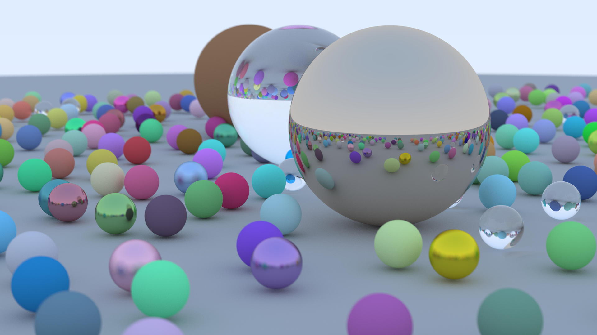

# raytracing-cuda-rs

This is another clone of raytracing in one weekend, using the new cuda-oxide rustc backend.



## Codegen

the ptx codegen sucks. I experienced implementation breaking codegen (see the workaround at [main.rs#L64-L71](https://github.com/Jark5455/raytracing-cuda-rs/blob/0bcee377bd2d044c77e25a1be71fd8e464289345/src/main.rs#L64-L71)). It also appears that incorrectly emits fixed sized `alloca`s at their use site rather than the functions entry block. This causes LLVM to mark inline-able functions as non inline-able, causing bad perf unless functions are marked with `#[inline(always)]`

## Performance

My benchmarks on Ryzen 9800x3d + RTX 5080

| Device | Sample Count | Time |
| --- | --- | --- |
| GPU (Cuda) | 1 | 68.914 ms |
| CPU (Rayon) | 1 | 484.61 ms |
| GPU (Cuda) | 4 | 251.39 ms |
| CPU (Rayon) | 4 | 1.9451 s |
| GPU (Cuda) | 8 | 493.87 ms |
| CPU (Rayon) | 8 | 3.9254 s |
| GPU (Cuda) | 16 | 951.61 ms |
| CPU (Rayon) | 16 | 7.9261 s |

Cuda performs better as expected.

## Setup

```bash
cargo oxide doctor
```

Fix anything doctor reports before building.

## Run

```bash
cargo oxide run
```
